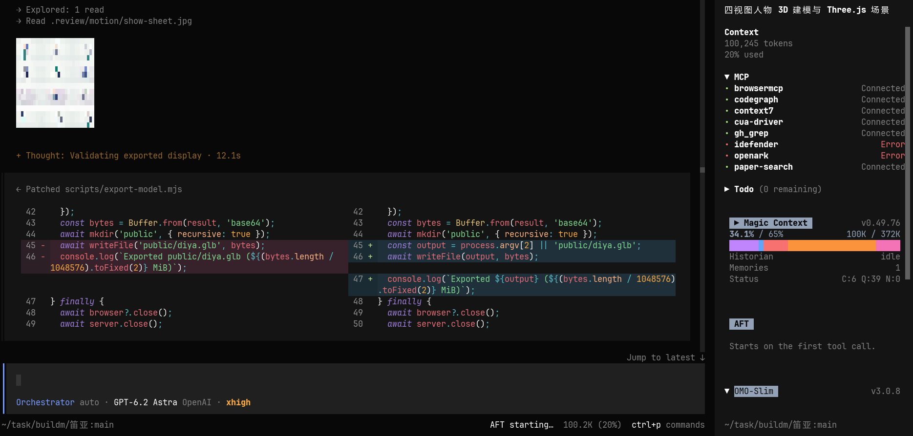
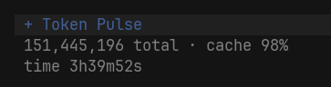

# 笛亚 · 三维角色图录

用 Three.js 制作的笛亚角色模型与动画查看器。拖动旋转模型，滚轮缩放；打开「参考对照」可查看四张原画。点「全部连播」，可以依次观看呼吸、招手、行礼和「空间契约·交换」。

## 运行

安装 [Bun](https://bun.sh/) 后运行：

```sh
git clone https://github.com/KomeijiReimu/diya-threejs.git
cd diya-threejs
bun run start
```

在浏览器打开终端显示的地址，默认为 [http://127.0.0.1:4173](http://127.0.0.1:4173)。

[下载带四段骨骼动画的 GLB 模型](https://github.com/KomeijiReimu/diya-threejs/raw/refs/heads/main/public/diya.glb)


[部分提示词](docs/部分提示词.md)


工作时截图



总耗费 token


